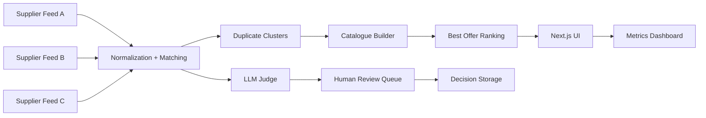

# Nexusstay

## Problem statement

Hotel suppliers often publish duplicate, partially inconsistent records for the same property. This creates fragmented inventory, confusing pricing comparisons, and unreliable customer choices. The goal is to merge records from multiple sources into a single trustworthy hotel catalogue and highlight the strongest offer while keeping human review for uncertain matches.

## Solution overview

Nexusstay combines a matching engine, LLM-based judgment layer, a catalogue builder, and a modern Next.js dashboard to unify supplier feeds into a single hotel view. Each merged hotel compares offers across price, cancellation flexibility, payment terms, and supplier reliability to rank the best-value option. Human review remains available for uncertain pairings, with decisions persisted locally in the browser to maintain continuity during refresh.

## Technology stack

- Python 3.11+
- FastAPI (backend contract expected by the product)
- Pandas for hotel record handling
- Groq API for LLM-based matching review
- SQLite for LLM cache persistence
- Next.js App Router
- TypeScript
- Tailwind CSS
- Recharts for analytics

## System architecture



## Setup instructions

1. Clone the repository.
2. Create a Python virtual environment and install dependencies:

```bash
python -m venv .venv
source .venv/bin/activate
pip install -r requirements.txt
```

3. Install the frontend dependencies:

```bash
cd web
npm install
```

4. Copy the example environment file and populate secrets:

```bash
cp .env.example .env
```

## Environment variables

| Variable | Purpose |
| --- | --- |
| GROQ_API_KEY | API key used by the Python judge layer |
| GROQ_MODEL_FAST | Fast model used first for matching decisions |
| GROQ_MODEL_STRONG | Strong model called when confidence falls below 0.7 |
| NEXT_PUBLIC_API_URL | Base URL for frontend API calls |

## Backend and frontend execution

### Python judge and catalogue logic

```bash
python -m pytest tests/test_llm_judge.py tests/test_offers.py -q
```

### Frontend development server

```bash
cd web
npm run dev
```

### Production frontend build

```bash
cd web
npm run build
```

## Results comparison

The project exposes a dashboard comparing the naive baseline with the engine on:

- Precision
- Recall
- F1 Score
- False merges from look-alike pairs
- LLM call count

Values are pulled from the API layer or mock API data during local development and are deliberately not hardcoded into the UI.

## Assumptions

- Suppliers provide structured enough data to support matching and offer comparison.
- Synthetic data is used for prototype and demo flows.
- Human review remains a required control point for uncertain matches.
- The FastAPI backend will expose the documented contract paths as specified.

## Known limitations

- The project is intentionally scoped to hotel-only workflows.
- The current UI uses mock data whenever the backend is unavailable, so production readiness depends on the backend contract being provided.
- LLM confidence is fallback-based and not a replacement for a full audit pipeline.

## Future scope

- Real supplier integrations and robust data pipelines
- More advanced deduplication with clustering and rule-based scoring
- Real backend persistence for review decisions and metrics
- Automated deployment pipelines and logging
